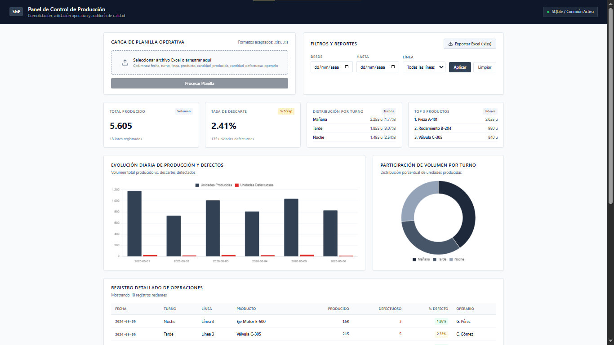
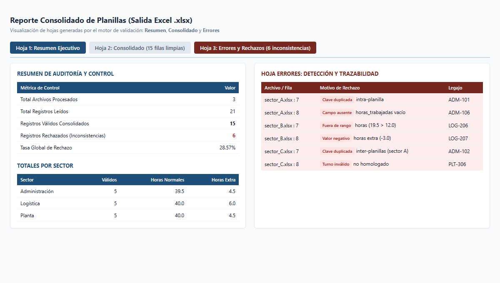

# Panel de Control de Producción y Validador de Planillas

> **Sistema web para ingesta de planillas Excel de producción con dashboard de KPIs y exportación de reportes.**

[](https://panel-de-control-de-producci-n-y.onrender.com/)

[](https://nodejs.org)
[](https://expressjs.com)
[](https://sqlite.org)
[](https://python.org)
[](https://pandas.pydata.org)
[](https://openpyxl.readthedocs.io)

---

## Vista Previa del Sistema

### 1. Panel de Control de Producción (Web + SQLite + SheetJS)
Interfaz gerencial formal diseñada para control operativo, análisis de scrap y auditoría de calidad:



### 2. Consolidador y Validador de Planillas (Python + Pandas + OpenPyXL)
Reporte ejecutivo generado automáticamente en 3 hojas (`Resumen`, `Consolidado` y `Errores`):



---

## Planillas de Prueba Incluidas (Listas para Probar)

No necesitás inventar datos. El repositorio incluye archivos reales de ejemplo:

| Proyecto | Archivo | Propósito de Prueba |
| :--- | :--- | :--- |
| **Panel Web** | [`panel-control-produccion/data/muestra.xlsx`](./panel-control-produccion/data/muestra.xlsx) | Lote de 18 registros limpios para carga y visualización inmediata de KPIs. |
| **Panel Web** | [`panel-control-produccion/data/muestra_con_errores.xlsx`](./panel-control-produccion/data/muestra_con_errores.xlsx) | Lote con errores deliberados (fechas inválidas, negativos, scrap > producción) para auditar el validador en pantalla. |
| **CLI Python** | [`consolidador-planillas/planillas_ejemplo/sector_A.xlsx`](./consolidador-planillas/planillas_ejemplo/sector_A.xlsx) | Turnos de Administración (incluye duplicado intra-planilla y celdas vacías). |
| **CLI Python** | [`consolidador-planillas/planillas_ejemplo/sector_B.xlsx`](./consolidador-planillas/planillas_ejemplo/sector_B.xlsx) | Turnos de Logística (incluye horas > 12 y horas extra negativas). |
| **CLI Python** | [`consolidador-planillas/planillas_ejemplo/sector_C.xlsx`](./consolidador-planillas/planillas_ejemplo/sector_C.xlsx) | Turnos de Planta (incluye duplicado inter-planillas y turno no homologado). |

---

## Proyectos del Repositorio

### Proyecto 1: Panel de Control de Producción
**Carpeta:** [`panel-control-produccion/`](./panel-control-produccion)

- **Qué resuelve:** Reemplaza la carga manual de partes diarios de fábrica. Ingesta planillas `.xlsx`, rechaza inconsistencias notificando fila y motivo, persiste en SQLite y expone un dashboard gerencial con exportación a Excel en un clic.
- **Métricas:** Volumen total, % de descarte (scrap), desglose por turno y ranking de productos.
- **Puesta en marcha local:**
  ```bash
  cd panel-control-produccion
  npm install
  npm start
  ```
  Abrir `http://localhost:3000`

---

### Proyecto 2: Consolidador y Validador de Planillas
**Carpeta:** [`consolidador-planillas/`](./consolidador-planillas)

- **Qué resuelve:** Unifica decenas de planillas departamentales dispersas en segundos, detecta duplicados por clave compuesta (`legajo` + `fecha`) entre distintas planillas y audita límites de horas según reglas declarativas (`config/reglas.yaml`).
- **Salida:** Libro `.xlsx` con 3 hojas estructuradas:
  1. `Resumen`: Métricas ejecutivas, horas normales/extra por sector y top 5 incidencias.
  2. `Consolidado`: Registros limpios con autofiltros y estilo corporativo Navy.
  3. `Errores`: Registros rechazados con trazabilidad de archivo, fila y motivo de error.
- **Puesta en marcha local:**
  ```bash
  cd consolidador-planillas
  python -m venv .venv
  .\.venv\Scripts\activate
  pip install -r requirements.txt
  python consolidar.py --input ./planillas_ejemplo --output ./reporte_consolidado.xlsx
  ```

---

## Acceso a la Aplicación en Vivo

La aplicación web se encuentra desplegada y operativa en Render:
- 🌐 **Demo en vivo:** [https://panel-de-control-de-producci-n-y.onrender.com/](https://panel-de-control-de-producci-n-y.onrender.com/)
- Podés probar cargar las planillas de prueba ([`muestra.xlsx`](./panel-control-produccion/data/muestra.xlsx) y [`muestra_con_errores.xlsx`](./panel-control-produccion/data/muestra_con_errores.xlsx)) directamente en la versión online.

---

## Estructura del Repositorio

```text
├── panel-control-produccion/          # Solución Web + Base de Datos + Dashboard
│   ├── src/                           # Backend Express, SQLite y servicios Excel
│   ├── public/                        # Frontend sobrio corporativo y Chart.js
│   ├── data/                          # Planillas de muestra (.xlsx)
│   ├── screenshots/                   # Capturas del dashboard
│   ├── package.json
│   └── README.md
│
├── consolidador-planillas/            # Solución CLI + Automatización Python
│   ├── consolidar.py                  # Motor de consolidación y estilizado
│   ├── config/reglas.yaml             # Reglas declarativas de validación
│   ├── planillas_ejemplo/             # Planillas departamentales de prueba
│   ├── screenshots/                   # Captura del reporte de 3 hojas
│   ├── requirements.txt
│   └── README.md
│
├── render.yaml                        # Blueprint de despliegue gratuito en Render
├── RESUMEN_PROYECTOS_CV_PORTFOLIO.txt # Guía lista para copiar y pegar en CV / LinkedIn
└── README.md                          # Índice general del repositorio
```
