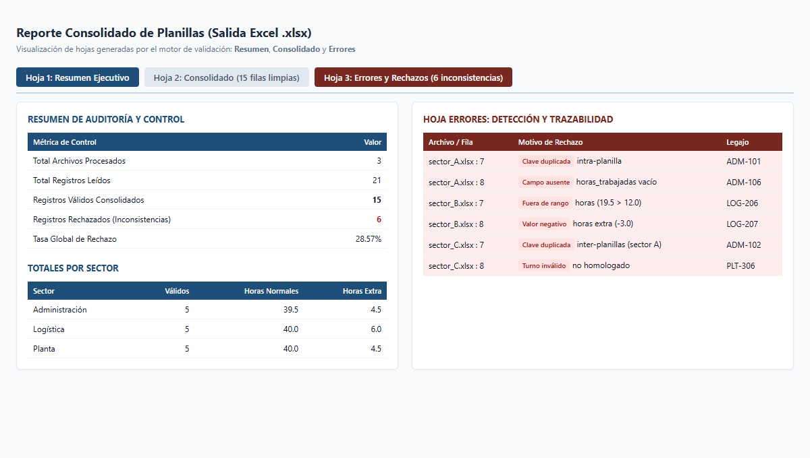

# Consolidador y Validador de Planillas

Herramienta CLI en Python para ingesta masiva, validación declarativa, detección de duplicados inter-planillas y consolidación de libros Excel en un reporte ejecutivo con 3 hojas estructuradas.



## Stack Tecnológico

- **Lenguaje:** Python 3.10+
- **Motor de Datos:** `pandas` (ingesta vectorial, limpieza y agrupaciones)
- **Motor Excel & Formato:** `openpyxl` (estilizado corporativo, autofiltros, anchos adaptativos y paleta de auditoría)
- **Configuración:** `PyYAML` (reglas declarativas de validación y límites operativos)
- **CLI:** `argparse` (interfaz por línea de comandos estándar)

## Qué problema resuelve

- **Elimina horas de labor manual:** Consolidar decenas de planillas departamentales a mano demanda horas de copiar y pegar; este proceso unifica los lotes en segundos.
- **Auditoría estricta de inconsistencias:** Detecta registros duplicados (incluso entre diferentes planillas por clave compuesta), campos obligatorios vacíos, turnos no homologados y horas fuera de rango legal.
- **Salida profesional para toma de decisiones:** Genera automáticamente un libro `.xlsx` con hojas separadas de **Resumen** (KPIs ejecutivos, totales por sector y top incidencias), **Consolidado** (datos limpios con autofiltro) y **Errores** (registros rechazados con trazabilidad de archivo, fila y motivo).

## Reglas Declarativas (`config/reglas.yaml`)

El sistema desacopla la lógica del motor de validación permitiendo modificar las reglas de negocio sin tocar el código:

```yaml
columnas_requeridas:
  - legajo
  - empleado
  - sector
  - fecha
  - turno
  - horas_trabajadas

clave_unicidad:
  - legajo
  - fecha

validaciones:
  horas_trabajadas:
    tipo: numeric
    min: 0.5
    max: 12.0
  horas_extra:
    tipo: numeric
    min: 0.0
    max: 8.0
  turnos_permitidos:
    - Mañana
    - Tarde
    - Noche
    - Rotativo
```

## Instalación y Uso

1. Acceder al directorio:
   ```bash
   cd consolidador-planillas
   ```

2. Crear y activar entorno virtual:
   ```bash
   # Windows
   python -m venv .venv
   .\.venv\Scripts\activate

   # Linux / macOS
   python3 -m venv .venv
   source .venv/bin/activate
   ```

3. Instalar dependencias:
   ```bash
   pip install -r requirements.txt
   ```

4. Ejecutar consolidación sobre planillas de ejemplo:
   ```bash
   python consolidar.py --input ./planillas_ejemplo --output ./reporte_consolidado.xlsx
   ```

### Parámetros CLI

| Parámetro | Alias | Default | Descripción |
| :--- | :--- | :--- | :--- |
| `--input` | `-i` | `./planillas_ejemplo` | Directorio con las planillas `.xlsx` de entrada |
| `--output` | `-o` | `./reporte_consolidado.xlsx` | Ruta del archivo Excel consolidado de salida |
| `--config` | `-c` | `./config/reglas.yaml` | Archivo YAML con las reglas de validación |

## Ejemplo de Ejecución

```text
==================================================================
 CONSOLIDADOR Y VALIDADOR DE PLANILLAS - AUDITORÍA DE DATOS
==================================================================
[INFO] Carpeta de entrada : .../planillas_ejemplo
[INFO] Archivo de reglas  : .../config/reglas.yaml
[INFO] Archivo de salida  : .../reporte_consolidado.xlsx
------------------------------------------------------------------
[OK] Archivos procesados   : 3 (sector_A.xlsx, sector_B.xlsx, sector_C.xlsx)
[OK] Total filas leídas    : 21
[OK] Registros válidos     : 15
[WARN] Registros rechazados : 6
[MÉTRICA] Tasa de descarte : 28.57%
------------------------------------------------------------------
[EXITO] Reporte generado satisfactoriamente:
        -> reporte_consolidado.xlsx
        -> Hojas: ['Resumen', 'Consolidado', 'Errores']
```

## Estructura del Libro Generado

1. **`Resumen`**: Portada ejecutiva con métricas globales (archivos, volumen, tasa de error), matriz de horas normales y extras por sector, y top 5 incidencias de validación.
2. **`Consolidado`**: Base depurada con encabezado Navy corporativo (`#1F4E79`), formato numérico decimal, autofiltro y dimensiones de celda ajustadas.
3. **`Errores`**: Detalle de filas rechazadas con encabezado Borgoña (`#78281F`), resaltado visual, indicando `archivo_origen`, `fila_origen` y el `motivo_rechazo`.
