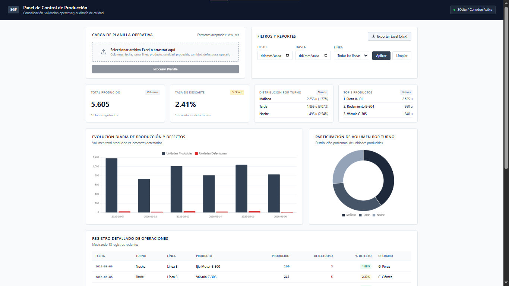

# Panel de Control de Producción

Sistema web para la ingesta, validación automatizada y análisis operativo de planillas de producción industrial con persistencia en base de datos relacional y exportación ejecutiva.

[](https://panel-de-control-de-producci-n-y.onrender.com/)

> **URL de producción:** [https://panel-de-control-de-producci-n-y.onrender.com/](https://panel-de-control-de-producci-n-y.onrender.com/)



## Stack Tecnológico

- **Backend:** Node.js, Express.js
- **Persistencia:** SQLite (integridad referencial, transacciones atómicas WAL)
- **Motor de Planillas:** SheetJS (`xlsx`) para parseo y generación de libros de cálculo
- **Frontend:** Vanilla HTML5, CSS3 corporativo (diseño sobrio orientado a operaciones industriales), JavaScript ES6+
- **Visualización:** Chart.js (evolución de volumen, scrap y distribución por turno)

## Qué problema resuelve

- **Elimina la carga manual:** Procesa planillas de turnos en segundos, rechazando automáticamente registros inconsistentes (cantidades negativas, fechas inválidas, discrepancias de descarte).
- **Consolida datos dispersos:** Centraliza lotes operativos multi-línea y multi-turno en un único repositorio relacional normalizado.
- **Genera reportes en 1 clic:** Exporta reportes consolidados en formato `.xlsx` con hojas separadas de "Resumen" gerencial y "Detalle" transaccional.

## Estructura de Planilla Requerida

El archivo Excel a importar (`.xlsx` o `.xls`) debe contener las siguientes columnas (se admiten variantes en mayúsculas/minúsculas y tildes):

| Columna | Tipo de Dato | Validación |
| :--- | :--- | :--- |
| `fecha` | Fecha / YYYY-MM-DD | Fecha válida |
| `turno` | Texto | No vacío (ej. Mañana, Tarde, Noche) |
| `linea` | Texto | No vacío (ej. Línea 1, Línea 2) |
| `producto` | Texto | Identificador o nombre del artículo |
| `cantidad_producida` | Entero | Mayor o igual a 0 |
| `cantidad_defectuosa` | Entero | Mayor o igual a 0 y menor o igual a cantidad_producida |
| `operario` | Texto | Nombre o identificador del responsable |

> Se incluyen planillas de prueba en la carpeta `data/`:
> - `data/muestra.xlsx`: Lote con 18 registros limpios para demostración inmediata.
> - `data/muestra_con_errores.xlsx`: Lote con casos deliberados de prueba (fechas inválidas, cantidades negativas y scrap inconsistente) para auditar el validador.

## Instalación y Puesta en Marcha

1. Acceder al directorio del proyecto:
   ```bash
   cd panel-control-produccion
   ```

2. Instalar dependencias:
   ```bash
   npm install
   ```

3. Iniciar la aplicación:
   ```bash
   npm start
   ```

4. Abrir en el navegador:
   `http://localhost:3000`

## Arquitectura de Carpetas

```text
panel-control-produccion/
├── data/
│   ├── muestra.xlsx             # Planilla de prueba limpia
│   ├── muestra_con_errores.xlsx # Planilla con casos de rechazo
│   └── produccion.db            # Base SQLite autogenerada
├── public/
│   ├── index.html               # Vista del panel gerencial
│   ├── styles.css               # Estilos sobrios corporativos
│   ├── dashboard.js             # Lógica cliente, KPIs y gráficos
│   └── vendor/
│       └── chart.umd.min.js     # Bundle local para ejecución offline
├── src/
│   ├── server.js                # Servidor Express y middleware
│   ├── db.js                    # Acceso a datos, esquema y consultas agregadas
│   ├── routes/
│   │   ├── upload.js            # Ingesta y validación de archivos
│   │   └── reportes.js          # Métricas, detalle y exportación
│   └── services/
│       ├── excelParser.js       # Validación y sanitización de filas
│       └── excelExport.js       # Construcción de libro Excel multi-hoja
├── package.json
└── README.md
```
